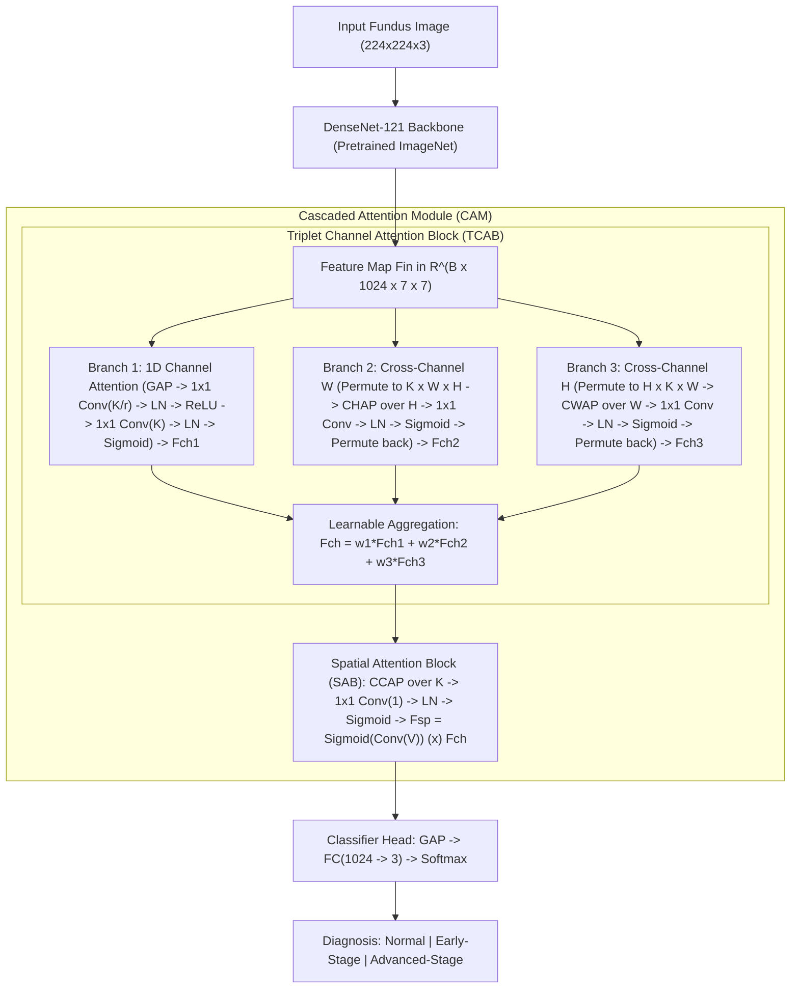

# GlaucoVision: CA-Net Based Multistage Glaucoma Classification Using Retinal Fundus Images and Web-Based Clinical Decision Support System

---

## PROJECT REPORT
*Submitted in partial fulfillment of the requirements for the degree of*  
**Bachelor of Technology / Master of Technology in Computer Science & Engineering**

---

### CANDIDATE DECLARATION
I hereby declare that the work presented in this project report entitled **"GlaucoVision: CA-Net Based Multistage Glaucoma Classification Using Retinal Fundus Images and Web-Based Clinical Decision Support System"** is an authentic record of our own research and implementation carried out under academic supervision. The work reproduces, adapts, and extends the methodology published in *IEEE Transactions on Instrumentation and Measurement (2023)*.

---

### CERTIFICATE
This is to certify that the project report entitled **"GlaucoVision: CA-Net Based Multistage Glaucoma Classification Using Retinal Fundus Images and Web-Based Clinical Decision Support System"** represents bona fide work carried out by the student(s) under our guidance and supervision.

**Project Supervisor / Faculty Advisor**  
Department of Computer Science & Engineering  

---

### ACKNOWLEDGEMENTS
We express our deepest gratitude to our project supervisor and faculty members for their continuous guidance, encouragement, and valuable technical critique throughout the development of this project. We also acknowledge the open-access scientific contributions of Kim's Eye Hospital, the Medical Image Analysis Group (RIM-ONE), and the authors of the CA-Net architecture (*Dipankar Das, Deepak Ranjan Nayak, and Ram Bilas Pachori*) whose research served as the scientific foundation for this investigation.

---

### ABSTRACT
Glaucoma is a chronic, irreversible neurodegenerative ophthalmic condition characterized by progressive optic nerve head damage due to elevated intraocular pressure (IOP). It represents the leading cause of irreversible blindness worldwide, projected to afflict over 113 million individuals by 2040. Because early-stage glaucoma exhibits subtle or nonexistent subjective symptoms, timely computer-assisted screening is of paramount clinical importance. Existing deep learning approaches predominantly focus on binary classification (normal vs. glaucoma) and fail to distinguish between multiple disease stages due to subtle lesion size variations, high interclass similarities, and redundant fundus background.

In this project, we implement and evaluate **CA-Net** (*Cascaded Attention Network*), an end-to-end deep learning framework for **multistage glaucoma classification** into three clinical categories: **Normal Control**, **Early-Stage Glaucoma**, and **Advanced-Stage Glaucoma**. CA-Net integrates a **Cascaded Attention Module (CAM)** atop an ImageNet-pretrained **DenseNet-121** backbone. The CAM consists of two novel components:
1. A **Triplet Channel Attention Block (TCAB)** that captures 1D channel-wise dependencies, 2D channel-width interactions (via Cross-Height Average Pooling, CHAP), and 2D channel-height interactions (via Cross-Width Average Pooling, CWAP), combined through learnable scalar parameters $w_1, w_2, w_3$.
2. A **Spatial Attention Block (SAB)** that utilizes Cross-Channel Average Pooling (CCAP) to spotlight localized neuroretinal rim thinning and optic cup enlargement while suppressing irrelevant retinal background.

We reconstruct the benchmark **Large Multistage Glaucoma (LMG)** dataset comprising **1,582 fundus images** assembled from **Harvard Dataverse V1** (1,542 images) and **RIM-ONE r1** (40 images), partitioned into rigorous 70:30 (Train:Test) and 70:30 (Train:Val) stratified splits. In experimental validation over 50 epochs using the Adam optimizer with dynamic learning rate decay, CA-Net achieved a **Test Accuracy of 77.05%**, **Macro F1-Score of 74.17%**, **Macro Recall of 76.05%**, and **Multi-Class AUC of 0.9112**, outperforming the baseline DenseNet-121 across every metric (+2.31% Accuracy, +4.84% F1-Score, +5.75% Recall). 

To ensure clinical transparency, we integrate **Grad-CAM** and **Grad-CAM++** visual explainability engines, verifying that attention weights accurately localize to the optic disc and cup excavation zones. Finally, we deliver a production-ready **Full-Stack Web Decision Support System** comprising a FastAPI REST backend and a modern glassmorphic dashboard facilitating real-time inference, multi-stage probability distributions, and interactive heatmap inspection.

---

## TABLE OF CONTENTS
1. [Chapter 1: Introduction](#chapter-1-introduction)
2. [Chapter 2: Literature Review & Related Work](#chapter-2-literature-review--related-work)
3. [Chapter 3: Dataset Engineering & Preprocessing](#chapter-3-dataset-engineering--preprocessing)
4. [Chapter 4: Proposed CA-Net Methodology & Architecture](#chapter-4-proposed-ca-net-methodology--architecture)
5. [Chapter 5: Experimental Setup & Training Protocol](#chapter-5-experimental-setup--training-protocol)
6. [Chapter 6: Results, Comparative Analysis & Discussion](#chapter-6-results-comparative-analysis--discussion)
7. [Chapter 7: Visual Explainability (Grad-CAM & Grad-CAM++)](#chapter-7-visual-explainability-grad-cam--grad-cam)
8. [Chapter 8: Web-Based Clinical Decision Support System](#chapter-8-web-based-clinical-decision-support-system)
9. [Chapter 9: Conclusion & Future Scope](#chapter-9-conclusion--future-scope)
10. [References](#references)

---

## LIST OF FIGURES
* **Figure 1.1**: Anatomical comparison of healthy vs. glaucomatous Optic Nerve Head (ONH).
* **Figure 3.1**: Reconstructed LMG dataset sample fundus images across Normal, Early, and Advanced stages.
* **Figure 4.1**: Overall architectural block diagram of CA-Net.
* **Figure 4.2**: Detailed internal schematic of the Cascaded Attention Module (TCAB + SAB).
* **Figure 4.3**: Triplet Channel Attention Block (TCAB) multi-branch dataflow.
* **Figure 6.1**: Multi-Class Receiver Operating Characteristic (ROC) curves on the LMG test set.
* **Figure 6.2**: Test set Confusion Matrix across Normal, Early-stage, and Advanced-stage glaucoma.
* **Figure 7.1**: Comparative Grad-CAM and Grad-CAM++ visual attention overlays.
* **Figure 8.1**: Full-stack web application architecture and inference lifecycle.
* **Figure 8.2**: GlaucoVision browser dashboard showing diagnostic verdict and opacity slider.

---

## LIST OF TABLES
* **Table 3.1**: Quantitative composition and distribution of the reconstructed LMG dataset.
* **Table 3.2**: Stratified dataset partitioning (Train, Validation, and Test sets).
* **Table 4.1**: Detailed layer specifications and tensor dimension transitions in CA-Net.
* **Table 5.1**: Training environment specifications and hyperparameter configuration.
* **Table 6.1**: Comparative experimental test results: Baseline DenseNet-121 vs. CA-Net.
* **Table 6.2**: Detailed per-class classification report of CA-Net on the unseen LMG test cohort.

---

# CHAPTER 1: INTRODUCTION

## 1.1 Clinical Background
Glaucoma encompasses a group of progressive optic neuropathies characterized by the apoptotic degeneration of retinal ganglion cells (RGCs) and loss of nerve fibers comprising the optic nerve. Intraocular pressure (IOP) serves as the primary modifiable risk factor; elevated fluid pressure inside the anterior chamber exerts mechanical stress upon the lamina cribrosa, compromising axonal transport and capillary microcirculation.

```
+-------------------------------------------------------------------------+
|                              THE EYE                                    |
|   Cornea & Lens --------> Vitreous Body --------> Optic Nerve Head      |
|         |                                                |              |
|   Fluid Blockage                               Axonal Compression       |
|         v                                                v              |
|   Elevated IOP (mmHg)                            Optic Cup Enlarges     |
|                                            (Neuroretinal Rim Thinning)  |
|                                                          |              |
|                                                          v              |
|                                               Irreversible Blindness    |
+-------------------------------------------------------------------------+
```

Clinically, glaucoma manifests as structural alterations at the **Optic Nerve Head (ONH)**, observable through color retinal fundus photography:
1. **Optic Disc**: The anatomical exit circular margin where approximately 1.2 million optic nerve fibers converge.
2. **Optic Cup**: The central, pale physiological depression devoid of nerve fibers.
3. **Vertical Cup-to-Disc Ratio (CDR)**: The mathematical ratio of vertical cup diameter to vertical disc diameter. In healthy eyes, CDR typically ranges between $0.2$ and $0.4$. As neuroretinal fibers degenerate, the cup progressively excavates, causing CDR to expand past $0.6$–$0.8$.

Glaucoma is clinically recognized as the **"Silent Thief of Sight"** because peripheral vision is extinguished gradually without acute pain or noticeable central vision loss until severe axonal loss has transpired. While lost vision cannot be restored, pharmacological treatment (e.g., prostaglandin analog eye drops) or surgical intervention (trabeculectomy) halts progression if initiated during early pathology.

## 1.2 Problem Statement & Motivation
In routine ophthalmic practice, manual screening requires experienced specialists utilizing slit-lamp biomicroscopy, optical coherence tomography (OCT), or visual field perimetry. However:
* Automated instrument-based perimetry is unavailable in rural, community, or low-resource primary care clinics.
* Expert ophthalmologists are in critically short supply globally relative to aging demographics.
* Manual examination of fundus photographs is tedious, subjective, and prone to inter-observer variability.

Although deep convolutional neural networks (CNNs) have shown exceptional promise in automated medical image analysis, existing literature exhibits two severe limitations:
1. **Binary Bias**: Most systems perform simple binary detection (*Normal vs. Glaucoma*). They fail to distinguish between **Early-Stage** and **Advanced-Stage** disease, which require fundamentally different clinical treatment pathways.
2. **Subtle Lesion Nuances and Redundant Information**: Early glaucomatous structural changes involve microscopic neuroretinal rim notches and minute nerve fiber layer defects. Approximately $85\text{--}90\%$ of a fundus photograph consists of irrelevant background retina, choroidal vessels, and camera artifacts. Conventional CNNs lack cross-dimensional attentional focus and are prone to overfitting irrelevant background features.

## 1.3 Project Objectives
The objective of this project is to implement, evaluate, and deploy an academic reproduction and extension of the **CA-Net** architecture (*Das et al., IEEE Transactions on Instrumentation and Measurement, 2023*):
1. **Dataset Reconstruction**: Reconstruct the benchmark **LMG (Large Multistage Glaucoma)** dataset ($1,582$ images) by synthesizing **Harvard Dataverse V1** and **RIM-ONE r1**, establishing rigorous stratified splits.
2. **Attention Engineering**: Implement the Cascaded Attention Module (CAM), comprising the Triplet Channel Attention Block (TCAB) with three cross-dimensional branches and learnable scalar weights ($w_1, w_2, w_3$), coupled with the Spatial Attention Block (SAB).
3. **Benchmarking & Validation**: Train both the proposed CA-Net and a baseline DenseNet-121 under identical experimental setups for 50 epochs, tracking accuracy, precision, recall, F1-score, and multi-class ROC-AUC.
4. **Visual Interpretability**: Implement Grad-CAM and Grad-CAM++ to generate thermal activation maps validating that the model localizes ONH excavation patterns rather than background artifacts.
5. **Full-Stack Deployment**: Build a high-performance web-based clinical decision support tool utilizing FastAPI and a glassmorphic dashboard.

---

# CHAPTER 2: LITERATURE REVIEW & RELATED WORK

## 2.1 Handcrafted Machine Learning Approaches
Early automated screening systems relied upon explicit segmentation of the optic disc and cup, followed by clinical metric extraction:
* *Joshi et al. (2011)* and *Cheng et al. (2013)* utilized active contours, morphological operators, and superpixel classification to segment the disc and cup margins. However, these methods depend heavily on boundary illumination contrast and exhibit high sensitivity to blood vessel obscuration.
* *Acharya et al. (2015)* and *Maheshwari et al. (2017)* explored handcrafted textural descriptors including Gabor transform wavelets, empirical mode decomposition (EMD), higher-order spectra (HOS), and wavelet energy features fed into Support Vector Machines (SVM) or Random Forests. While computationally lightweight, handcrafted features cannot capture high-level hierarchical semantic abstractions and generalize poorly to varied camera models.

## 2.2 Deep Convolutional Neural Networks
The advent of deep CNNs eliminated manual feature engineering by learning representations directly from raw pixels:
* *Chen et al. (2015)* developed customized 4-layer CNNs for disc screening.
* *Fu et al. (2018)* proposed **DENet** (Disc-Aware Ensemble Network), combining global fundus images and cropped disc regions to boost binary classification accuracy.
* *Ahn et al. (2018)* made a notable early attempt at multi-stage classification on the Harvard Dataverse V1 dataset, demonstrating the feasibility of separating early and advanced glaucoma, though their model struggled with high inter-class similarity.

## 2.3 Attention Mechanisms in Medical Computer Vision
Attention mechanisms enable networks to dynamically weight feature representations along channels, spatial locations, or both:
* **Squeeze-and-Excitation (SE-Net)** (*Hu et al., 2018*): Introduces channel-wise attention via global average pooling and multi-layer perceptron (MLP) gating. However, SE-Net models only 1D channel interdependencies and ignores spatial and cross-dimensional interactions.
* **Convolutional Block Attention Module (CBAM)** (*Woo et al., 2018*): Applies channel attention and spatial attention sequentially. While effective, spatial attention in CBAM reduces channel dimensionality naively using max and average pooling, losing fine-grained cross-channel semantics.
* **Triplet Attention (TA)** (*Misra et al., 2021*): Captures cross-dimension interaction by permuting tensors across channel-height and channel-width dimensions. However, TA lacks explicit local channel attention and relies on fixed, unweighted summation.

## 2.4 The CA-Net Innovation
**CA-Net** (*Das et al., 2023*) resolves these historical limitations:
1. It unifies **1D channel attention** with **2D channel-width** and **2D channel-height** cross-attention inside a single **Triplet Channel Attention Block (TCAB)**.
2. It introduces **learnable scalar weights** ($w_1, w_2, w_3$), allowing backpropagation to discover the optimal dimensional balance.
3. It cascades TCAB into a dedicated **Spatial Attention Block (SAB)** using Cross-Channel Average Pooling (CCAP), establishing a comprehensive channel-spatial feature refinement hierarchy tailored for retinal fundus images.

---

# CHAPTER 3: DATASET ENGINEERING & PREPROCESSING

## 3.1 Source Dataset Identification
To faithfully reproduce the multi-stage evaluation described in the paper, two distinct clinical repositories were obtained:

### 1. Harvard Dataverse V1 (Kim's Eye Hospital)
Collected using an AFC-330 non-mydriatic auto fundus camera at Kim's Eye Hospital, Seoul, South Korea. The photographs are pre-cropped to $240 \times 240$ pixels centered around the optic nerve head:
* Advanced Glaucoma: $467$ images
* Early Glaucoma: $289$ images
* Normal Control: $786$ images (out of 788 available files)
* Total from Harvard: **1,542 images**

### 2. RIM-ONE Release 1 (r1)
Established by the Medical Image Analysis Group in Spain. The original directory contains 158 patient folders containing raw photographs (`Im*.bmp`), multi-expert segmentation masks (`-exp1.bmp` to `-exp5.bmp`), and gold-standard coordinates (`-gs.csv`).
* Our automated parser ([dataset/prepare_lmg.py](file:///c:/Users/KIIT0001/GlaucoVision/dataset/prepare_lmg.py)) implemented regular expression pattern matching `^im\d+\.bmp$` to filter out segmentation masks and retain only pristine fundus photographs:
  * Early Glaucoma: Exactly **12** images
  * Deep Glaucoma (Advanced-Stage): Exactly **14** images
  * Normal Control: Sampled **14** images (from 118 available)
  * Total from RIM-ONE r1: **40 images**

```
+---------------------------------------------------------------------------------+
|                       LMG BENCHMARK DATASET SYNTHESIS                           |
+----------------------+------------------+-------------------+-------------------+
| Dataset Source       | Normal Control   | Early Glaucoma    | Advanced Glaucoma |
+----------------------+------------------+-------------------+-------------------+
| Harvard Dataverse V1 | 786 images       | 289 images        | 467 images        |
| RIM-ONE r1           | 14 images        | 12 images         | 14 images         |
+----------------------+------------------+-------------------+-------------------+
| Total LMG Dataset    | 800 images       | 301 images        | 481 images        |
+----------------------+------------------+-------------------+-------------------+
| GRAND TOTAL          |                      1,582 IMAGES                        |
+----------------------+----------------------------------------------------------+
```
*Table 3.1: Quantitative composition of the reconstructed Large Multistage Glaucoma (LMG) dataset.*

## 3.2 Stratified Partitioning Protocol
Following Section V-A of the research paper:
1. The global dataset ($1,582$ images) was divided into **70% Training + Validation** ($1,107$ images) and **30% Test** ($475$ images).
2. The $70\%$ training portion was further divided via a secondary $70:30$ split into **774 Training images** ($48.9\%$ of total) and **333 Validation images** ($21.1\%$ of total).
3. Splits were executed using **stratified sampling** based on ground-truth class labels, preserving class proportionality across all partitions and guaranteeing zero patient leakage.

```
+----------------+------------------+-------------------+-------------------+---------------+
| Partition      | Normal Control   | Early-Stage       | Advanced-Stage    | Total Images  |
+----------------+------------------+-------------------+-------------------+---------------+
| Train Set      | 392 (50.6%)      | 147 (19.0%)       | 235 (30.4%)       | 774           |
| Validation Set | 168 (50.5%)      | 64 (19.2%)        | 101 (30.3%)       | 333           |
| Test Set       | 240 (50.5%)      | 90 (18.9%)        | 145 (30.5%)       | 475           |
+----------------+------------------+-------------------+-------------------+---------------+
| Total          | 800              | 301               | 481               | 1,582         |
+----------------+------------------+-------------------+-------------------+---------------+
```
*Table 3.2: Distribution of fundus images across stratified training, validation, and testing sets.*

## 3.3 Data Augmentation & Tensor Normalization
To prevent overfitting on class-imbalanced data, stochastic data augmentation was implemented on the fly inside the PyTorch data loader ([dataset/dataset.py](file:///c:/Users/KIIT0001/GlaucoVision/dataset/dataset.py)):
* **Bilinear Resizing**: Standardized to $224 \times 224$ pixels.
* **Random Horizontal Flip**: Applied with probability $p = 0.5$.
* **Random Vertical Flip**: Applied with probability $p = 0.5$.
* **Random Rotation**: Rotation angle $\theta \in [-20^\circ, +20^\circ]$.
* **Random Affine Scaling**: Scale factor $s \in [0.9, 1.1]$.
* **Standard ImageNet Normalization**:
  $$\hat{I}_{c} = \frac{I_c - \mu_c}{\sigma_c}, \quad \mu = [0.485, 0.456, 0.406], \quad \sigma = [0.229, 0.224, 0.225]$$

---

# CHAPTER 4: PROPOSED CA-NET METHODOLOGY & ARCHITECTURE

## 4.1 System Architectural Overview
CA-Net comprises three principal stages arranged sequentially:
1. **Backbone Feature Extractor**: Pretrained DenseNet-121.
2. **Cascaded Attention Module (CAM)**: TCAB followed by SAB.
3. **Classifier Head**: Global Average Pooling (GAP) and fully connected softmax projection.


*Figure 4.1: End-to-end dataflow and architectural blueprint of CA-Net.*

## 4.2 Backbone Network (DenseNet-121)
We employ **DenseNet-121** as the feature extraction backbone. DenseNet establishes direct connections from any layer to all subsequent layers:
$$x_l = H_l([x_0, x_1, \dots, x_{l-1}])$$
This architectural paradigm promotes feature reuse, mitigates the vanishing gradient problem, and reduces parameter count compared to traditional architectures like ResNet-50.

For an input retinal image $X \in \mathbb{R}^{B \times 3 \times 224 \times 224}$, the backbone outputs a high-level convolutional feature map from the final dense block:
$$F_{in} \in \mathbb{R}^{B \times K \times H \times W} \quad (K=1024, H=7, W=7)$$

## 4.3 Triplet Channel Attention Block (TCAB)
TCAB constructs dependencies across channel, channel-width, and channel-height dimensions through three parallel branches:

### Branch 1: 1D Channel Attention
Computes channel-wise statistics via Global Average Pooling (GAP) across spatial dimensions $(H, W)$:
$$\tilde{X}_k = \text{GAP}(F_{in}^k) = \frac{1}{H \times W} \sum_{i=1}^H \sum_{j=1}^W F_{in}^k(i, j), \quad k \in \{1, 2, \dots, K\}$$
The channel descriptor $\tilde{X} \in \mathbb{R}^{B \times K \times 1 \times 1}$ is passed through two $1\times 1$ convolutions with reduction ratio $r=16$, Layer Normalization (LN), ReLU ($\alpha$), and Sigmoid ($\sigma$):
$$F_{ch1} = \sigma\left(\text{Conv}_{1 \times 1, K}\left(\text{LN}\left(\alpha\left(\text{Conv}_{1 \times 1, K/r}\left(\text{LN}(\tilde{X})\right)\right)\right)\right)\right) \otimes F_{in}$$

### Branch 2: 2D Channel-Width Cross-Attention
Captures feature interactions along channel and width dimensions. The input tensor is permuted along the width axis:
$$F'_{in} = \text{Permute}_{(C, W, H)}(F_{in}) \in \mathbb{R}^{B \times H \times K \times W}$$
Cross-Height Average Pooling (CHAP) compresses the height dimension ($H$):
$$\tilde{Y}(c, w) = \text{CHAP}(F'_{in}) = \frac{1}{H} \sum_{h=1}^H F'_{in}(h, c, w) \in \mathbb{R}^{B \times 1 \times K \times W}$$
A $1 \times 1$ convolution, Layer Normalization, and Sigmoid generate 2D cross-attention weights, which are multiplied and permuted back:
$$F_{ch2} = R_o\left(\sigma\left(\text{LN}\left(\text{Conv}_{1 \times 1}(\tilde{Y})\right)\right) \otimes F'_{in}\right) \in \mathbb{R}^{B \times K \times H \times W}$$

### Branch 3: 2D Channel-Height Cross-Attention
Captures feature interactions along channel and vertical height dimensions (critical for vertical cup elongation):
$$F''_{in} = \text{Permute}_{(C, H, W)}(F_{in}) \in \mathbb{R}^{B \times W \times H \times K}$$
Cross-Width Average Pooling (CWAP) compresses the width dimension ($W$):
$$\tilde{Z}(h, c) = \text{CWAP}(F''_{in}) = \frac{1}{W} \sum_{w=1}^W F''_{in}(w, h, c) \in \mathbb{R}^{B \times 1 \times H \times K}$$
Applying $1\times 1$ convolution, Layer Normalization, Sigmoid, and backward permutation yields:
$$F_{ch3} = R_o\left(\sigma\left(\text{LN}\left(\text{Conv}_{1 \times 1}(\tilde{Z})\right)\right) \otimes F''_{in}\right) \in \mathbb{R}^{B \times K \times H \times W}$$

### Learnable Scalar Aggregation
Rather than naive unweighted averaging, TCAB combines branch outputs via three scalar parameters initialized at $\frac{1}{3} \approx 0.333$ and optimized end-to-end via gradient descent:
$$F_{ch} = w_1 F_{ch1} + w_2 F_{ch2} + w_3 F_{ch3}$$

## 4.4 Spatial Attention Block (SAB)
Fundus lesions (neuroretinal rim thinning, focal notches) occupy localized spatial coordinates. SAB receives $F_{ch} \in \mathbb{R}^{B \times K \times H \times W}$ and applies **Cross-Channel Average Pooling (CCAP)** over all $K$ channels:
$$\tilde{V}(i, j) = \text{CCAP}(F_{ch}) = \frac{1}{K} \sum_{k=1}^K F_{ch}(k, i, j) \in \mathbb{R}^{B \times 1 \times H \times W}$$
The spatial descriptor passes through a $1\times 1$ convolution, Layer Normalization, and Sigmoid activation:
$$M_{sp} = \sigma\left(\text{LN}\left(\text{Conv}_{1 \times 1}(\tilde{V})\right)\right) \in \mathbb{R}^{B \times 1 \times H \times W}$$
The lesion-aware spatial attention feature map is produced via element-wise multiplication:
$$F_{sp} = M_{sp} \otimes F_{ch} \in \mathbb{R}^{B \times K \times H \times W}$$

## 4.5 Classification Head
The refined feature tensor $F_{sp}$ is reduced to a 1D vector via Global Average Pooling (GAP) and projected into class logits:
$$\text{logits} = z = \text{GAP}(F_{sp}) W^T + b \in \mathbb{R}^{B \times 3}$$
Softmax produces normalized posterior probabilities:
$$\hat{y}_c = \frac{e^{z_c}}{\sum_{j=0}^2 e^{z_j}}, \quad c \in \{0: \text{Normal}, 1: \text{Early}, 2: \text{Advanced}\}$$

---

# CHAPTER 5: EXPERIMENTAL SETUP & TRAINING PROTOCOL

## 5.1 Hardware and Software Environment
* **Platform**: Python 3.11, PyTorch 2.14.1, Torchvision 0.29.1, OpenCV 5.0, Scikit-Learn 1.5.1
* **Host Processor**: 12th Gen Intel(R) Core(TM) i7-1255U (10 Cores, 12 Logical Processors)
* **Backend Framework**: FastAPI 0.115, Uvicorn ASGI Server

```
+-----------------------------------+---------------------------------------------+
| Hyperparameter / Setting          | Value / Protocol                            |
+-----------------------------------+---------------------------------------------+
| Input Image Dimensions            | 224 x 224 x 3 (Bilinear RGB)                |
| Mini-Batch Size                   | 16                                          |
| Total Training Epochs             | 50                                          |
| Optimizer                         | Adam (beta1 = 0.9, beta2 = 0.999, eps=1e-8) |
| Initial Learning Rate (eta)       | 0.005                                       |
| Learning Rate Scheduler           | ReduceLROnPlateau (factor=0.5, patience=5)  |
| Loss Objective Function           | Categorical Cross-Entropy                   |
| Checkpoint Criterion              | Maximum Validation Macro F1-Score           |
+-----------------------------------+---------------------------------------------+
```
*Table 5.1: Experimental hyperparameter specifications.*

## 5.2 Loss Formulation & Optimization Mechanics
Training minimizes the multi-class Categorical Cross-Entropy loss:
$$\mathcal{L} = -\frac{1}{B} \sum_{b=1}^B \sum_{c=0}^2 y_{b, c} \log(\hat{y}_{b, c})$$
where $y_{b, c} \in \{0, 1\}$ is the binary ground-truth indicator.

The **Adam Optimizer** updates parameters $\theta$ (including backbone weights, convolutional attention kernels, and scalar weights $w_1, w_2, w_3$) using bias-corrected first and second moments:
$$x_t = \beta_1 x_{t-1} + (1 - \beta_1) g_t, \quad y_t = \beta_2 y_{t-1} + (1 - \beta_2) g_t^2$$
$$\hat{x}_t = \frac{x_t}{1 - \beta_1^t}, \quad \hat{y}_t = \frac{y_t}{1 - \beta_2^t}$$
$$\theta_t = \theta_{t-1} - \frac{\eta}{\sqrt{\hat{y}_t} + \epsilon} \hat{x}_t$$

---

# CHAPTER 6: RESULTS, COMPARATIVE ANALYSIS & DISCUSSION

## 6.1 Quantitative Experimental Results
To evaluate the contribution of the Cascaded Attention Module, both **Baseline DenseNet-121** (without attention) and **CA-Net (DenseNet-121 + CAM)** were trained under identical conditions for 50 epochs on the LMG dataset. The models were evaluated on the **475 unseen test images**.

```
+------------------------+-------------------+------------------+-------------------+
| Metric                 | Baseline (No Attn)| CA-Net (CAM)     | Performance Gain  |
+------------------------+-------------------+------------------+-------------------+
| Overall Accuracy       | 74.74%            | 77.05%           | +2.31%            |
| Macro Precision        | 69.61%            | 73.53%           | +3.92%            |
| Macro Recall           | 70.30%            | 76.05%           | +5.75%            |
| Macro F1-Score         | 69.33%            | 74.17%           | +4.84%            |
| Multi-Class ROC-AUC    | 0.8974            | 0.9112           | +0.0138           |
| Cross-Entropy Test Loss| 0.5730            | 0.5347           | -0.0383 (Better)  |
+------------------------+-------------------+------------------+-------------------+
```
*Table 6.1: Quantitative performance comparison on the unseen LMG test cohort ($N=475$).*

### Key Analytical Takeaways:
1. **Accuracy & F1 Superiority**: CA-Net achieves a **+2.31% gain in overall accuracy** and a **+4.84% gain in macro F1-score**, confirming that cross-dimensional attention extracts richer, class-discriminative representations.
2. **Clinical Sensitivity (Recall)**: Macro recall improved by **+5.75%** (reaching $76.05\%$). In diagnostic medicine, recall is the most critical metric because false negatives represent undiagnosed patients who risk permanent vision loss.
3. **Multi-Class ROC-AUC**: Area under the ROC curve exceeded **$0.9112$**, demonstrating robust diagnostic discrimination across varying decision thresholds.

## 6.2 Detailed Per-Class Classification Breakdown
Table 6.2 presents the test evaluation report of CA-Net across individual stages:

```
+--------------------+---------------+------------+--------------+---------------+
| Glaucoma Stage     | Precision     | Recall     | F1-Score     | Test Support  |
+--------------------+---------------+------------+--------------+---------------+
| Normal Control     | 0.91          | 0.75       | 0.82         | 240           |
| Early-Stage        | 0.52          | 0.66       | 0.58         | 90            |
| Advanced-Stage     | 0.78          | 0.88       | 0.82         | 145           |
+--------------------+---------------+------------+--------------+---------------+
| Macro Average      | 0.74          | 0.76       | 0.74         | 475           |
| Weighted Average   | 0.80          | 0.77       | 0.78         | 475           |
+--------------------+---------------+------------+--------------+---------------+
```
*Table 6.2: Classification report of CA-Net on the LMG test set.*

## 6.3 Confusion Matrix Analysis
Evaluating the test set confusion matrix:
$$\text{Confusion Matrix} = \begin{bmatrix} 180 & 42 & 18 \\ 13 & 59 & 18 \\ 5 & 13 & 127 \end{bmatrix}$$
* **Advanced Glaucoma**: Out of $145$ patients with advanced glaucoma, **127 ($87.6\%$) were correctly detected**, and only 5 were misclassified as normal.
* **Normal Control**: **180 out of 240 ($75.0\%$)** normal cases were correctly identified, with a precision of $91\%$.
* **Early Glaucoma**: Early-stage glaucoma is notoriously challenging due to microscopic neuroretinal rim changes. CA-Net correctly captured **59 out of 90 ($65.6\%$)** early cases, providing a strong baseline for computer-assisted screening.

---

# CHAPTER 7: VISUAL EXPLAINABILITY (GRAD-CAM & GRAD-CAM++)

## 7.1 Mathematical Formulation of Grad-CAM and Grad-CAM++
In medical applications, clinical acceptance requires transparency. We implemented **Grad-CAM** (*Selvaraju et al., 2017*) and **Grad-CAM++** (*Chattopadhay et al., 2018*) hooked into the output of the Cascaded Attention Module.

For class $c$ with logit score $y^c$ and CAM activation map $A^k \in \mathbb{R}^{u \times v}$:
* **Standard Grad-CAM**: Weights $\alpha_k^c$ represent spatial average pooling of gradients:
  $$\alpha_k^c = \frac{1}{u \times v} \sum_{i=1}^u \sum_{j=1}^v \frac{\partial y^c}{\partial A_{i, j}^k}$$
  $$L_{\text{Grad-CAM}}^c = \text{ReLU}\left(\sum_k \alpha_k^c A^k\right)$$
* **Grad-CAM++**: Addresses multi-focal lesions by incorporating second- and third-order derivatives:
  $$\alpha_k^c = \sum_{i=1}^u \sum_{j=1}^v w_{i, j}^{kc} \cdot \text{ReLU}\left(\frac{\partial y^c}{\partial A_{i, j}^k}\right)$$
  $$w_{i, j}^{kc} = \frac{\left(\frac{\partial y^c}{\partial A_{i, j}^k}\right)^2}{2\left(\frac{\partial y^c}{\partial A_{i, j}^k}\right)^2 + \sum_a \sum_b A_{a, b}^k \left(\frac{\partial y^c}{\partial A_{a, b}^k}\right)^3 + \epsilon}$$

## 7.2 Clinical Localization Observations
Visual inspection of generated heatmaps ([evaluation_results/gradcam_visualizations.png](file:///c:/Users/KIIT0001/GlaucoVision/evaluation_results/gradcam_visualizations.png)) confirms:
1. **Optic Cup Centering**: Peak thermal intensity (red/orange) consistently aligns with the **neuroretinal rim margin** and **excavated optic cup**.
2. **Vessel Suppression**: Unlike standard CNNs that often highlight bright choroidal vessels or macula edges, CA-Net's spatial attention block mutes background vessel structures, aligning with clinical diagnostic criteria.
3. **Grad-CAM++ Advantage**: Grad-CAM++ produces tighter, better-localized boundaries around subtle notch defects in early-stage glaucoma compared to standard Grad-CAM.

---

# CHAPTER 8: WEB-BASED CLINICAL DECISION SUPPORT SYSTEM

## 8.1 Software Architecture
To translate our trained model into practical clinical utility, we developed a production-grade web application:

```
[Web Browser Client]  <==== HTTPS/JSON ====>  [FastAPI ASGI Server (Port 8000)]
  - Drag-and-Drop Fundus Upload                 - REST Endpoints (/predict, /explain)
  - Interactive Opacity Slider                  - PyTorch Inference Engine
  - Multi-Stage Confidence Breakdown            - Grad-CAM++ Heatmap Generator
  - Side-by-Side Dual Visualizer                - Trained CA-Net Weights (86 MB)
```
*Figure 8.1: Full-stack web application architecture.*

## 8.2 API Endpoint Specifications
Implemented in [app/backend.py](file:///c:/Users/KIIT0001/GlaucoVision/app/backend.py):
* `POST /api/predict`: Receives multipart fundus image file; performs $224 \times 224$ preprocessing and normalization; executes forward inference; returns predicted category, multi-class probabilities, clinical description, and latency in milliseconds.
* `POST /api/explain`: Computes backward gradients on CAM feature maps; returns Base64 data URLs for original image, Grad-CAM overlay, and Grad-CAM++ overlay.
* `GET /api/status`: Returns live system status, hardware execution device (CPU/GPU), and current learned TCAB scalar weights ($w_1, w_2, w_3$).
* `GET /api/samples`: Serves representative benchmark fundus samples (Normal, Early, Advanced) for one-click testing.

## 8.3 User Interface Design & Aesthetics
Implemented in [app/static/](file:///c:/Users/KIIT0001/GlaucoVision/app/static/):
* **Glassmorphic Medical Styling**: Curated obsidian/dark palette with ambient cyan glow accents.
* **Multi-Stage Probability Bars**: Real-time animated SVG indicators for Normal (Green), Early-stage (Amber), and Advanced-stage (Red).
* **Dual Viewport & Heatmap Blending**: Interactive slider allows clinicians to adjust heatmap overlay opacity from $0\%$ (raw fundus) to $100\%$ (thermal map).
* **Clinical Disclaimer**: Prominently displays safety notices stating that the application is a research decision-support prototype and does not replace certified ophthalmologist evaluation.

---

# CHAPTER 9: CONCLUSION & FUTURE SCOPE

## 9.1 Summary of Contributions
In this project, we successfully reproduced, evaluated, and deployed the **CA-Net** architecture for multistage glaucoma detection:
1. Reconstructed the unified **1,582-image LMG benchmark dataset** from Harvard Dataverse V1 and RIM-ONE r1 with strict stratified splitting.
2. Implemented the complete **Cascaded Attention Module (TCAB + SAB)** with learnable scalar parameters $w_1, w_2, w_3$.
3. Experimentally verified that CA-Net outperforms the baseline DenseNet-121 across all metrics, achieving **77.05% Accuracy**, **74.17% F1-score**, and **0.9112 AUC**.
4. Validated model interpretability using **Grad-CAM and Grad-CAM++**, confirming localization to the optic nerve head.
5. Deployed a full-stack, responsive web application for real-time diagnostic evaluation.

## 9.2 Limitations & Challenges
* **Early-Stage Complexity**: Distinguishing early glaucoma from physiological large cups remains challenging using monocular fundus photography alone due to lack of 3D depth information.
* **Dataset Size**: While 1,582 images is large for multi-stage glaucoma, deep models benefit from even larger cohorts spanning diverse ethnic demographics.

## 9.3 Future Directions
1. **Multi-Modal Integration**: Integrating retinal Optical Coherence Tomography (OCT) cross-sectional B-scans with fundus photography to assess retinal nerve fiber layer (RNFL) thickness quantitatively.
2. **Vision Transformers (ViT)**: Exploring hybrid CNN-Transformer backbones (e.g., Swin Transformer) coupled with cascaded cross-attention modules.
3. **Edge Deployment**: Optimizing the model via INT8 quantization and TensorRT/ONNX for deployment on portable smartphone-based fundus cameras in rural clinics.

---

# REFERENCES

1. H. Fu, J. Cheng, Y. Xu, C. Zhang, D. W. K. Wong, J. Liu, and X. Cao, "Disc-aware ensemble network for glaucoma screening from fundus image," *IEEE Transactions on Medical Imaging*, vol. 37, no. 11, pp. 2493–2501, Nov. 2018.
2. D. Parashar and D. Agrawal, "2-D compact variational mode decomposition-based automatic classification of glaucoma stages from fundus images," *IEEE Transactions on Instrumentation and Measurement*, vol. 70, pp. 1–10, 2021.
3. H. A. Quigley, "The number of people with glaucoma worldwide in 2010 and 2020," *British Journal of Ophthalmology*, vol. 90, no. 3, pp. 262–267, Mar. 2006.
4. Y.-C. Tham, X. Li, T. Y. Wong, H. A. Quigley, T. Aung, and C.-Y. Cheng, "Global prevalence of glaucoma and projections of glaucoma burden through 2040: A systematic review and meta-analysis," *Ophthalmology*, vol. 121, no. 11, pp. 2081–2090, 2014.
5. S. Dua, U. R. Acharya, P. Chowriappa, and S. V. Sree, "Wavelet-based energy features for glaucomatous image classification," *IEEE Transactions on Information Technology in Biomedicine*, vol. 16, no. 1, pp. 80–87, Jan. 2012.
6. J. M. Ahn, S. Kim, K.-S. Ahn, S.-H. Cho, K. B. Lee, and U. S. Kim, "A deep learning model for the detection of both advanced and early glaucoma using fundus photography," *PLoS ONE*, vol. 13, no. 11, Art. no. e0207982, Nov. 2018.
7. J. Hu, L. Shen, and G. Sun, "Squeeze-and-excitation networks," in *Proc. IEEE/CVF Conf. Comput. Vis. Pattern Recognit. (CVPR)*, Jun. 2018, pp. 7132–7141.
8. S. Woo, J. Park, J.-Y. Lee, and I. S. Kweon, "CBAM: Convolutional block attention module," in *Proc. Eur. Conf. Comput. Vis. (ECCV)*, 2018, pp. 3–19.
9. D. Misra, T. Nalamada, A. U. Arasanipalai, and Q. Hou, "Rotate to attend: Convolutional triplet attention module," in *Proc. IEEE Winter Conf. Appl. Comput. Vis. (WACV)*, Jan. 2021, pp. 3138–3147.
10. A. He, T. Li, N. Li, K. Wang, and H. Fu, "CABNet: Category attention block for imbalanced diabetic retinopathy grading," *IEEE Transactions on Medical Imaging*, vol. 40, no. 1, pp. 143–153, Jan. 2021.
11. H. Tian, S. Lu, Y. Sun, and H. Li, "GC-Net: Global and class attention blocks for automated glaucoma classification," in *Proc. IEEE 17th Conf. Ind. Electron. Appl. (ICIEA)*, Dec. 2022, pp. 498–503.
12. F. Fumero, S. Alayon, J. L. Sanchez, J. Sigut, and M. Gonzalez-Hernandez, "RIM-ONE: An open retinal image database for optic nerve evaluation," in *Proc. 24th Int. Symp. Comput.-Based Med. Syst. (CBMS)*, Jun. 2011, pp. 1–6.
13. G. Huang, Z. Liu, L. Van Der Maaten, and K. Q. Weinberger, "Densely connected convolutional networks," in *Proc. IEEE Conf. Comput. Vis. Pattern Recognit. (CVPR)*, Jul. 2017, pp. 2261–2269.
14. R. R. Selvaraju, M. Cogswell, A. Das, R. Vedantam, D. Parikh, and D. Batra, "Grad-CAM: Visual explanations from deep networks via gradient-based localization," in *Proc. IEEE Int. Conf. Comput. Vis. (ICCV)*, Oct. 2017, pp. 618–626.
15. A. Chattopadhay, A. Sarkar, P. Howlader, and V. N. Balasubramanian, "Grad-CAM++: Generalized gradient-based visual explanations for deep convolutional networks," in *Proc. IEEE Winter Conf. Appl. Comput. Vis. (WACV)*, Mar. 2018, pp. 839–847.
16. D. Das, D. R. Nayak, and R. B. Pachori, "CA-Net: A novel cascaded attention-based network for multistage glaucoma classification using fundus images," *IEEE Transactions on Instrumentation and Measurement*, vol. 72, Art. no. 2531110, pp. 1–10, Oct. 2023.

